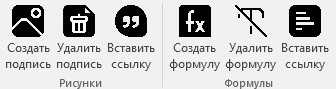
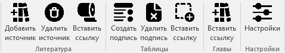
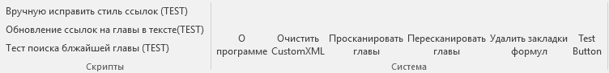
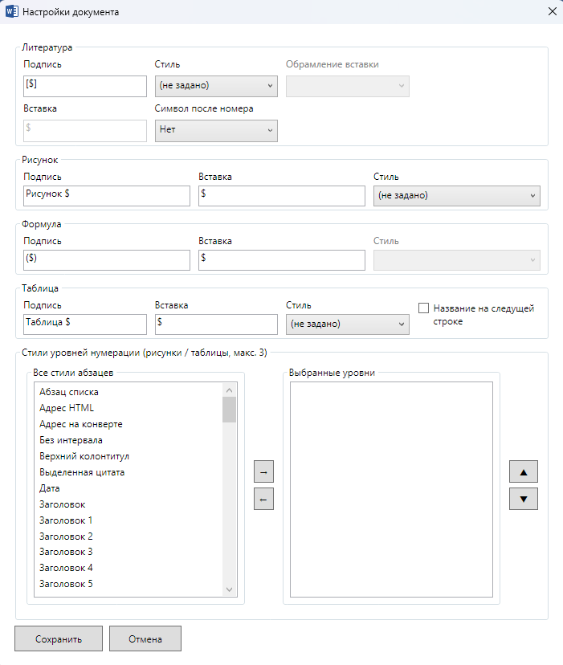
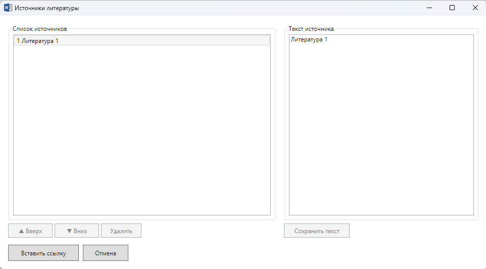
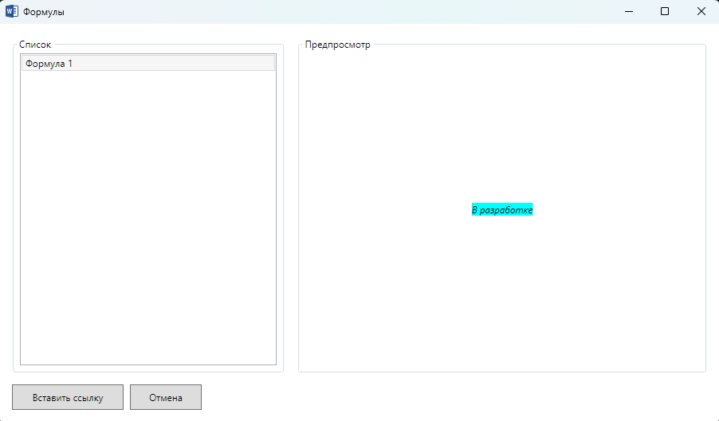
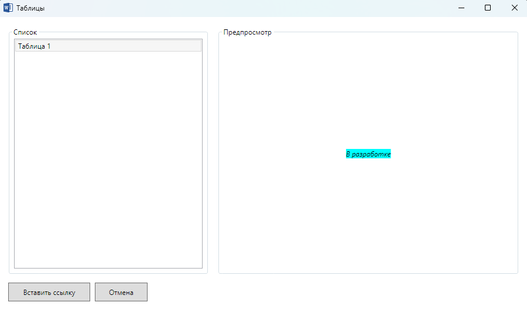

# XtendedRefs — COM-надстройка для Microsoft Word

> Управление перекрёстными ссылками на рисунки, формулы, таблицы и литературу прямо в документе.

[](../../releases)
[]()
[]()

## 📋 Содержание

- [Что это](#что-это)
- [Возможности](#возможности)
- [Дорожная карта](#дорожная-карта)
- [Установка](#установка)
  - [Для разработчика](Dev-build)
- [Использование](#использование)
  - [Вкладка «Оформление»](#вкладка-оформление)
  - [Настройки документа](#настройки-документа)
- [Скриншоты](#скриншоты)
- [Технические детали](#технические-детали)
- [FAQ / Известные ограничения](#faq--известные-ограничения)

---

## Что это

**XtendedRefs** — COM-надстройка (DLL, загружается как InprocServer32), которая встраивается в Microsoft Word и добавляет вкладку **«Оформление»** на ленту. 

Она помогает авторам технической документации:

- Создавать пронумерованные подписи к рисункам, таблицам, формулам и литературе по заданному в настройках шаблону.
- Хранить и удобно управлять всеми подписями и ссылками.
- Все данные хранятся непосредственно внутри самого документа (записываются в поле CustomXML).

**Технические параметры:**

| | |
|---|---|
| Язык / фреймворк | C# · .NET Framework 4.7.2 |
| Тип COM-объекта | InprocServer32, `HKCU` (без прав администратора) |
| ProgID | `XtendedRefs.ComAddIn` |
| Целевой Word | 2016[^1] (x86 / x64, определяется автоматически) |
| UI | Ribbon XML + WPF-диалоги |

[^1]: Тесты выполнены только для конкретной версии
---

## Возможности


| Функция        | Что умеет сейчас                           | Статус |
|----------------|--------------------------------------------|---|
| **Литература** | Добавление источника литературы.           | 🟡 Рабочая (альфа версия)|
| **Формулы**    | Создание подписей формул объектов MathType | 🟡 Рабочая (альфа версия) |
| **Таблицы**    | Создание подписей таблиц.                  | 🟡 Рабочая (альфа версия)|
| **Рисунки**    | Создание подписей рисунков.                | 🟡 Рабочая (альфа версия)|


---

## Дорожная карта

- [ ] Изменение всех ссылок и номеров при изменении шаблона в настройках
- [ ] Добавление возможности экспорта и импорта шаблона
- [ ] Добавление превью для формул, таблиц и рисунков
- [ ] Упрощение работы функционала и дополнительные удобства

---


## Установка

### Dev-build
На данный момент присутствует один способ установки расширения - компиляция и его подключение. Для этого собран удобный скрипт.
```powershell
.\dev-build-activate.cmd                 # компиляция Debug DLL + dev-registration
```
В дальнейшем предусмотрена сборка установщика в виде исполняемого файла exe.

---

### Вкладка «Оформление»

После установки в Word появляется вкладка **«Оформление»** с четырьмя группами кнопок:

| Группа | Кнопки |
|---|---|
| **Рисунки** | Создать подпись · Удалить подпись · Вставить ссылку |
| **Формулы** | Создать формулу · Удалить формулу ·  Вставить ссылку |
| **Литература** | Добавить источник · Удалить источник · Вставить ссылку |
| **Таблицы** | Создать подпись · Удалить подпись · Вставить ссылку |

### Настройки документа

Нажмите **«Настройки»** (иконка шестерёнки) — откроется WPF-окно `SettingsWindow`. Там можно задать:

- Шаблон подписи (`$` = знак местозаполнителя).
- Стиль заголовка для извлечения номерa главы (в случае, если нумерация не сквозная а по главам).
- Разделитель между номером и текстом источника литературы (пробел, табуляция, пустое).

Настройки сохраняются как **переменные документа** — переносятся с файлом DOCX.

---
## Использование

1. Необходимо настроить шаблоны для подписей и вставки.
2. Для добавления нового источника литературы необходимо:<br>
    &nbsp;&nbsp;&nbsp;&nbsp;2\.1. Вставить в текст полную литературную ссылку.<br> 
    &nbsp;&nbsp;&nbsp;&nbsp;2\.2. Поставить курсор в любом месте вставленного текста ссылки и нажать "Добавить источник".  
3. Для добавления новой ссылки на таблицу поставить курсор в месте, где будет будущее название и нажать "Создать подпись" во вкладке "Таблицы".
4. Для добавления новой ссылки на рисунок вставить рисунок и поставить курсор на следующей строке после рисунка, где будет будущее название и нажать "Создать подпись" во вкладке "Рисунки".
5. Для добавления ссылки на формулу[^3] необходимо вставить саму формулу, нажать на нее (после нажатия она должна выделиться контуром) и нажать "Создать формулу".

[^3]: На данный момент поддерживается только работа формул типа **MathType object**
---

## Скриншоты

<!-- Screenshot: Ribbon tab «Оформление» -->
|                                                                          |
|:------------------------------------------------------------------------:|
|                                      |
| <br>*Основные управляющие кнопки* |
|          <br>*Тестовые кнопки*          |

<!-- Screenshot: SettingsWindow — настройки шаблонов и стилей -->


<!-- Screenshot: LiteraturePicker — список источников с превью -->


<!-- Screenshot: Formula preview update -->


<!-- Screenshot: Table caption above/below toggle -->


---

## Технические детали

### Закладки (bookmark prefixes)

Технические названия закладок строятся по типу "служебное имя" + GUID. Сами по себе закладки являются скрытыми. При работе с расширением в диалоговых окнах название будет "человеческим".

---

## Известные ограничения

1. #### При смене настроек шаблона (добавление учета главы или наоборот сквозная нумерация) в тексте ничего не меняется (в процессе доработки).
2. #### Использование только сквозной нумерации для литературы (использование дополнительных местозаполнителей приведет к непредсказуемому поведению). 


---

<!-- ENGLISH STUB -->

## English (coming soon)

> This extension requires localization and adaptation for international audiences.
> The README is currently in Russian only. We plan to add full English documentation,
> translated UI labels, and locale-aware default templates in a future release.

---
